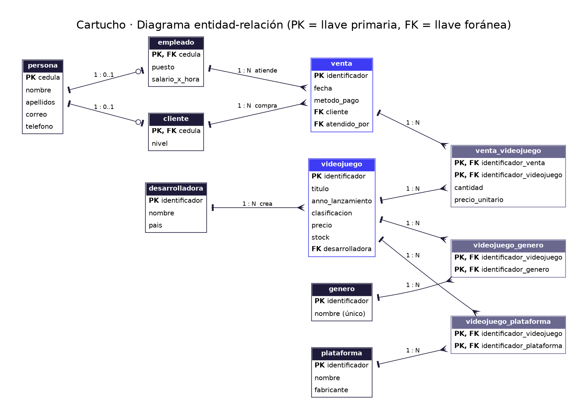

# Cartucho: análisis y diseño

## 1. Análisis

### Nombre del proyecto
**Cartucho**, sistema web de administración para una tienda de videojuegos.

### Descripción del problema
Una tienda pequeña de videojuegos vende títulos de muchos tipos: shooters, indies, juegos de historia, RPG y más, para varias consolas. Si lleva el inventario en cuadernos u hojas sueltas, aparecen varios problemas:

- No sabe con rapidez cuántas copias quedan de cada juego.
- Le cuesta responder a un cliente que pregunta "¿qué shooters tienen para PS5?".
- Repite datos, porque el mismo juego aparece en varias listas (por género, por consola).
- No tiene un registro confiable de qué se vendió, a quién y qué empleado atendió.

### Objetivo general
Desarrollar una aplicación web que permita a la tienda registrar, consultar, modificar y eliminar la información de sus videojuegos, clientes, empleados y ventas. Todo se guarda en una base de datos SQLite a la que se accede por medio de una API hecha con FastAPI.

### Principales funcionalidades
- **Catálogo:** muestra todos los juegos con precio, stock, clasificación por edad, géneros y plataformas, con filtro por género.
- **CRUD completo** de personas, clientes, empleados, videojuegos, géneros, plataformas, desarrolladoras y ventas.
- **Relaciones muchos a muchos:** asignar géneros y plataformas a cada juego, y agregar juegos a una venta.
- **Detalle de venta:** muestra un recibo con los juegos vendidos y el total calculado desde la base de datos.
- **Validación de datos:** no se aceptan precios negativos, años imposibles ni cantidades en cero. Tampoco se permite borrar un registro que otro esté usando, como un género asignado a un juego.

### Usuarios del sistema
| Usuario | Qué hace en el sistema |
|---|---|
| Vendedor(a) | Consulta el catálogo, registra clientes y ventas. |
| Encargado(a) de inventario | Agrega juegos, actualiza precios y stock, asigna géneros y plataformas. |
| Administrador(a) | Administra empleados y revisa el historial de ventas. |

## 2. Diseño de la base de datos

### Diagrama entidad-relación

(También está en `diagrama_er.pdf` y su código fuente en `diagrama_er.dot`.)

### Descripción de las tablas

| Tabla | Descripción | Llave primaria | Llaves foráneas |
|---|---|---|---|
| persona | Datos generales de cualquier persona (nombre, correo, teléfono). | cedula | No tiene |
| cliente | Persona que compra en la tienda; guarda su nivel (Casual, VIP...). | cedula | cedula → persona |
| empleado | Persona que trabaja en la tienda; guarda puesto y salario por hora. | cedula | cedula → persona |
| desarrolladora | Estudio que creó el juego y su país. | identificador | No tiene |
| genero | Tipo de juego: Shooter, Indie, Historia, RPG, etc. El nombre no se puede repetir. | identificador | No tiene |
| plataforma | Consola o sistema (PS5, Xbox, Switch, PC) y su fabricante. | identificador | No tiene |
| videojuego | Juego a la venta: título, año, clasificación, precio y stock. | identificador | desarrolladora → desarrolladora |
| venta | Compra realizada: fecha, método de pago, cliente y empleado que atendió. | identificador | cliente → cliente, atendido_por → empleado |
| videojuego_genero | Indica qué géneros tiene cada juego. | (identificador_videojuego, identificador_genero) | ambas columnas |
| videojuego_plataforma | Indica en qué plataformas está cada juego. | (identificador_videojuego, identificador_plataforma) | ambas columnas |
| venta_videojuego | Juegos incluidos en cada venta, con cantidad y precio al momento de vender. | (identificador_venta, identificador_videojuego) | ambas columnas |

### Relaciones
| Relación | Tipo | Explicación |
|---|---|---|
| persona – cliente | 1 a 0..1 | Una persona puede ser cliente (o no). |
| persona – empleado | 1 a 0..1 | Una persona puede ser empleado (o no). |
| cliente – venta | 1 a N | Un cliente puede tener muchas ventas. |
| empleado – venta | 1 a N | Un empleado puede atender muchas ventas. |
| desarrolladora – videojuego | 1 a N | Una desarrolladora puede crear muchos juegos. |
| videojuego – genero | N a N | Un juego tiene varios géneros y un género tiene muchos juegos (tabla `videojuego_genero`). |
| videojuego – plataforma | N a N | Un juego sale en varias plataformas y cada plataforma tiene muchos juegos (tabla `videojuego_plataforma`). |
| venta – videojuego | N a N | Una venta incluye varios juegos y un juego aparece en muchas ventas (tabla `venta_videojuego`). |

### Reglas de integridad
- `PRAGMA foreign_keys = ON` hace que SQLite revise todas las llaves foráneas.
- `ON DELETE RESTRICT` impide borrar, por ejemplo, una persona que sea cliente o un género asignado a algún juego.
- `ON DELETE CASCADE` hace que, al borrar un juego o una venta, se borren también sus filas en las tablas de relación.
- Los `CHECK` evitan precios, stock o salarios negativos, cantidades en cero y años de lanzamiento menores a 1970.
